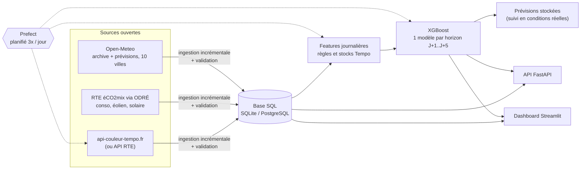

# Prévision des jours Tempo EDF

Pipeline Data Engineering + Machine Learning qui prévoit la couleur des prochains jours de l'option **Tempo** d'EDF (Bleu / Blanc / Rouge), à partir de **données réelles** et ouvertes.

- Dès que RTE publie la couleur du lendemain (vers 11h), c'est la couleur **officielle** qui est affichée.
- Pour les jours encore inconnus (jusqu'à J+5 après la dernière couleur publiée), c'est la **prévision du modèle**, avec ses probabilités.

---

## Architecture



| Étape | Fichier |
|---|---|
| Configuration (sources, villes, règles, planning) | [src/config.py](src/config.py) |
| Stockage SQL + upsert idempotent | [src/storage.py](src/storage.py) |
| Ingestion (Tempo, éCO2mix, météo) | [src/ingestion/](src/ingestion/) |
| Règles Tempo (saison, quotas, calendrier) | [src/processing/tempo_rules.py](src/processing/tempo_rules.py) |
| Contrôles qualité des données | [src/processing/validation.py](src/processing/validation.py) |
| Features | [src/processing/features.py](src/processing/features.py) |
| Entraînement + backtest | [src/models/train.py](src/models/train.py) |
| Inférence | [src/models/predict.py](src/models/predict.py) |
| Orchestration Prefect + planificateur | [src/pipeline.py](src/pipeline.py) |
| API | [src/api/main.py](src/api/main.py) |
| Dashboard | [dashboard/app.py](dashboard/app.py) |

## Comment le problème est posé

**Une ligne = un jour cible J**, vu depuis le moment où la dernière couleur officielle connue est celle de K = J − h (h = horizon). Le modèle n'utilise **que ce qui est connu à ce moment-là** :

| Famille | Variables |
|---|---|
| Météo du jour J | température moyenne/min/max France (10 villes pondérées par population), moyenne sur 3 jours, vent à 100 m (éolien), rayonnement (solaire), nébulosité |
| Consommation du jour R = K − 1 | conso moyenne et max, conso nette (− éolien − solaire), moyenne 7 jours, écart de température entre R et J |
| Calendrier de J | jour de semaine, mois, férié, jour dans la saison, éligibilité rouge/blanc |
| État de la saison Tempo | rouges/blancs restants, jours éligibles restants, « pression » (stock / jours restants), couleur de K, série de rouges en cours |

**Règles Tempo** (vérifiées sur l'historique réel 2019-2026), appliquées comme contraintes dures sur les probabilités :

- une saison va du 1er septembre au 31 août, avec 22 rouges et 43 blancs ;
- le dimanche est toujours bleu ;
- le rouge tombe uniquement du lundi au vendredi, du 1er novembre au 31 mars, hors jours fériés ;
- jamais plus de 5 rouges consécutifs ;
- jamais de blanc le dimanche ;
- une couleur dont le stock est épuisé devient impossible.

## Performance (backtest honnête)

Chaque saison de 2021-2022 à 2025-2026 est prédite par un modèle entraîné **uniquement sur les saisons précédentes**. Les chiffres portent sur 1 826 jours.

| Méthode (J+1) | F1 macro | Exactitude | Rappel rouge | Précision rouge | Rappel blanc |
|---|---|---|---|---|---|
| **Modèle XGBoost** | **0,77** | **0,91** | **0,62** | **0,80** | **0,68** |
| Heuristique « froid + stock » | 0,58 | 0,86 | 0,30 | 0,89 | 0,27 |
| Toujours bleu | 0,30 | 0,82 | 0 | – | 0 |

Le F1 macro reste entre 0,75 et 0,76 de J+2 à J+5. L'exactitude seule est trompeuse : 82 % des jours sont bleus. Les métriques à suivre sont donc le **F1 macro** et le **rappel rouge**.

Matrice de confusion à J+1 (lignes = réel, colonnes = prévu) :

| | prévu Bleu | prévu Blanc | prévu Rouge |
|---|---|---|---|
| **réel Bleu** | 1 440 | 60 | 1 |
| **réel Blanc** | 53 | 146 | 16 |
| **réel Rouge** | 8 | 34 | 68 |

> **Limite connue :** à l'entraînement, la météo de J est la météo *observée*. En production, c'est une *prévision* Open-Meteo, un peu moins précise, surtout au-delà de J+2. Les performances réelles sont donc légèrement inférieures au backtest à long horizon. La table `predictions` enregistre chaque prévision émise pour mesurer cet écart (endpoint `/predictions/track-record` et dashboard).

## Démarrage

Aucune clé d'API n'est nécessaire.

### Avec Docker (recommandé)

```bash
docker compose up --build
```

1. `init` télécharge tout l'historique, entraîne les modèles et produit une prévision. Comptez environ 2 minutes au premier lancement.
2. Ensuite `api`, `dashboard` et `scheduler` démarrent. Le scheduler relance le pipeline chaque jour à 07:00, 11:30 et 18:00 (heure de Paris).

- Dashboard : http://localhost:8501
- API : http://localhost:8000/docs

Les données et les modèles sont conservés dans `./data`.

### En local (Python 3.11+)

```bash
pip install -r requirements-dev.txt
cp .env.example .env            # optionnel

python -m src.pipeline run      # ingestion + entraînement + prévision
streamlit run dashboard/app.py  # dashboard
uvicorn src.api.main:app        # API
python -m src.pipeline schedule # exécution quotidienne automatique
```

Autres commandes :
- `python -m src.pipeline train` : ré-entraîner et refaire le backtest ;
- `python -m src.pipeline predict` : afficher la prévision en JSON ;
- `python -m src.pipeline run --retrain` : forcer le ré-entraînement.

Les modèles sont ré-entraînés automatiquement tous les 7 jours (`RETRAIN_EVERY_DAYS`). L'API et le dashboard rechargent les nouveaux modèles sans redémarrer.

## API

| Endpoint | Description |
|---|---|
| `GET /forecast?days=5` | aujourd'hui et les prochains jours : couleur officielle ou prévue, avec probabilités |
| `GET /tempo/{date}` | couleur d'un jour (officielle ou prévue) |
| `GET /season` | stocks rouges/blancs utilisés et restants de la saison en cours |
| `GET /history?season=2025-2026` | calendrier officiel d'une saison |
| `GET /predictions/track-record?horizon=1` | prévisions émises comparées à la réalité |
| `GET /model` | version, variables, importance, métriques de backtest |
| `GET /health` | état du modèle et fraîcheur des données |

## Configuration (.env)

Voir [.env.example](.env.example). Principaux paramètres :

- `TEMPO_SOURCE` : `auto` utilise l'API officielle RTE si `RTE_CLIENT_ID` et `RTE_CLIENT_SECRET` sont renseignés, sinon api-couleur-tempo.fr. Valeurs possibles : `rte`, `public`.
- `DATABASE_URL` : SQLite par défaut (`data/tempo.db`). Pour PostgreSQL, `postgresql+psycopg://...`.
- `SCHEDULE_TIMES`, `RETRAIN_EVERY_DAYS`, `HORIZONS`.
- `DISABLE_PREFECT=1` : exécute les mêmes étapes sans Prefect.

## Données stockées

| Table | Contenu | Source |
|---|---|---|
| `tempo_days` | couleur officielle par jour (depuis 2019-09) | api-couleur-tempo.fr / RTE |
| `consumption_daily` | conso moyenne/min/max, éolien, solaire, prévision J-1 RTE, taux de complétude | ODRÉ éCO2mix (données consolidées et temps réel) |
| `weather_daily` | météo France pondérée, `source` = archive ou prévision (une prévision n'écrase jamais une observation) | Open-Meteo |
| `predictions` | chaque prévision émise (date cible, horizon, probabilités, version du modèle) | pipeline |

Chaque exécution ne re-télécharge que les derniers jours, sur une fenêtre glissante qui absorbe les corrections et consolidations. L'insertion se fait en *upsert* : relancer le pipeline ne crée jamais de doublons.

## Qualité

```bash
pytest -q             # 14 tests : règles Tempo, features (absence de fuite), stockage, API, entraînement
ruff check src dashboard tests
```

La CI GitHub Actions ([.github/workflows/ci.yml](.github/workflows/ci.yml)) lance le lint, les tests et le build Docker à chaque push.

## Pistes d'amélioration

- Entraîner sur des **prévisions météo archivées** (Open-Meteo *historical forecast API*) plutôt que sur la météo observée, pour supprimer l'écart entre backtest et production.
- Ajouter la **prévision de consommation RTE J+1** (déjà stockée dans `prevision_j1_mean`) comme variable pour l'horizon J+1, après avoir vérifié son heure de publication.
- Calibrer les probabilités (isotonic) et alerter par e-mail ou notification quand P(rouge) > 50 %.
